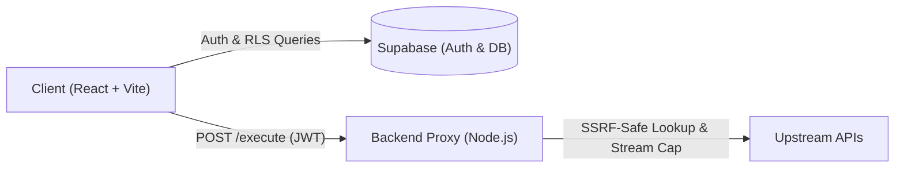

# APIForge

**APIForge** is a security-focused web API development and testing client built with React, TypeScript, Node.js, and Supabase. Serving as a modern web alternative to desktop tools like Postman, it combines a responsive browser workspace with an SSRF-defended backend proxy, multi-tenant database isolation, nested collection hierarchies, environment variable interpolation, and multi-language code generation.

[Live Demo](https://api-forge-hazel.vercel.app/) · [GitHub Repository](https://github.com/Atharvakadu24/APIForge)

---

## Overview & Architecture

Browser security policies prevent direct client-side JavaScript from issuing requests to arbitrary third-party endpoints. APIForge bridges this gap using an authenticated backend proxy built with defense-in-depth protections against Server-Side Request Forgery (SSRF) and credential leakage.



---

## Key Features

- **Request Composer & Execution:** Supports `GET`, `POST`, `PUT`, `PATCH`, and `DELETE` with real-time two-way query parameter synchronization, Bearer and API-key authentication, in-flight request cancellation (`AbortSignal`), and configurable timeouts (1s–60s).
- **Body Formats:** Syntax-highlighted JSON editor with parse validation and formatting, raw text, `x-www-form-urlencoded`, and text-field `multipart/form-data` with dynamic boundary generation.
- **Dynamic Variable Interpolation:** Reference environment variables anywhere with `{{variable_name}}` across URLs, query parameters, headers, bodies, and auth tokens, backed by an environment manager (Dev, Staging, Prod).
- **Hierarchical Collections & Persistence:** Multi-level nested folders, cycle-detected folder moves, dirty-state tracking indicators, and a 50-item FIFO request history log.
- **Productivity & Code Generation:** Global Command Palette (`Ctrl+K`), formatted JSON response viewer with text search and line numbers, single-request JSON import/export, and instant code generation in **cURL**, **JavaScript Fetch**, **Python Requests**, and **Axios**.
- **Responsive Interface:** Optimized for mobile phones (320px+), tablets, and desktops with an adaptive slide-over drawer navigation.

---

## Tech Stack

| Layer | Technologies |
|---|---|
| **Frontend** | React 19, TypeScript, Vite, Tailwind CSS |
| **Backend** | Node.js, Express, TypeScript, native `net` / `dns` / `http` / `https` |
| **Database & Auth** | Supabase (PostgreSQL 15+ with Row-Level Security, GoTrue Auth) |
| **Testing & Tooling** | Node.js Test Runner, Oxlint, TypeScript compiler (`tsc`) |

---

## Security Highlights

APIForge implements defense-in-depth security to safely proxy HTTP requests:

- **Multi-Layer SSRF Defense:** Destination URLs and resolved IP addresses are validated against restricted IPv4 and IPv6 CIDR blocks (blocking loopback, RFC 1918 private subnets, carrier-grade NAT, cloud metadata endpoints such as `169.254.169.254`, link-local, and reserved ranges).
- **Socket-Level DNS Hook:** Attaches a custom lookup hook to Node's `http.Agent` and `https.Agent` to validate resolved IPs immediately prior to socket creation, mitigating DNS rebinding (TOCTOU) risks.
- **Redirect Header Sanitization:** Automatically strips sensitive headers (`Authorization`, `Cookie`, `Proxy-Authorization`, and API keys) whenever redirects (up to 5 hops) cross origin boundaries.
- **Stream Cutoffs & Resource Bounds:** Upstream response streams exceeding 10MB are aborted immediately at the socket level (`HTTP 413`) to defend against memory exhaustion.
- **Authentication & Rate Limiting:** Proxy execution requires a verified Supabase JWT bearer token, throttled by an in-memory fixed-window rate limiter (120 req/min per IP).
- **Multi-Tenant Isolation:** Database tables enforce tenant isolation via PostgreSQL Row-Level Security (`auth.uid() = user_id`) and relational composite foreign keys.

---

## Getting Started

### Prerequisites
- Node.js (v18+) and npm
- A free [Supabase](https://supabase.com) project for PostgreSQL and Authentication

### 1. Database Setup
Apply the canonical migration script in your Supabase SQL Editor:
```text
supabase/migrations/20261011_production_schema_complete.sql
```

### 2. Environment Configuration

Create `backend/.env`:
```env
PORT=3001
ALLOWED_ORIGINS=http://localhost:5173,http://127.0.0.1:5173
SUPABASE_URL=https://your-project-id.supabase.co
SUPABASE_ANON_KEY=your-supabase-anon-key
```

Create `frontend/.env.local`:
```env
VITE_SUPABASE_URL=https://your-project-id.supabase.co
VITE_SUPABASE_PUBLISHABLE_KEY=your-supabase-anon-key
VITE_BACKEND_URL=http://localhost:3001
```

### 3. Installation & Run

```bash
# Terminal 1 — Backend
cd backend
npm install
npm run dev

# Terminal 2 — Frontend
cd frontend
npm install
npm run dev
```

Open `http://localhost:5173` in your browser.

---

## Testing & Quality

APIForge includes **61 automated deterministic test scenarios** executed locally without live external dependencies:

- **Backend Test Suite (38 scenarios):** Covers SSRF CIDR validation, IPv4/IPv6 edge cases, redirect sanitization, 10MB stream cutoffs, socket teardown, client abort propagation, fixed-window rate limiting, security headers, and JWT verification.
- **Frontend Test Suite (23 scenarios):** Covers authentication lifecycle, session restoration, error message formatting, recovery tokens, offline tenant-query filter validation, and UI accessibility.

```bash
# Run backend tests (38/38 passing, from repository root)
npm test --prefix backend

# Run frontend tests (23/23 passing, from repository root)
npm test --prefix frontend

# Lint & build checks (from repository root)
npm run lint --prefix frontend
npm run build --prefix frontend
npm run build --prefix backend
```

> **Note on Database Testing:** The automated test suites run offline using in-process servers and mocks. PostgreSQL Row-Level Security policies are defined declaratively in migrations; test Scenario 14 asserts query-filter construction offline rather than against a live database instance.

---

## Scope & Limitations

- **Protocol Scope:** Designed specifically for HTTP/HTTPS REST APIs. WebSockets, Server-Sent Events (SSE), and gRPC streams are not supported.
- **Localhost Testing:** Because the backend proxy blocks loopback (`127.0.0.1`) and private IPs to defend against SSRF, testing local development servers requires tunneling (e.g., ngrok or Cloudflare Tunnel) or deploying to a staging environment.
- **Form Data & Files:** `multipart/form-data` supports key-value text fields with dynamic multipart boundary formatting; binary file picker attachments (`<input type="file">`) are not currently implemented in the UI.
- **Rate Limiting:** The backend uses an in-memory fixed-window limiter suitable for single-instance hosting. Clustered deployments would require a shared store (e.g., Redis).
- **History Retention:** Request history is capped at 50 items using client-tier FIFO pruning.

---

## Author & License

- **Author:** [Atharva Kadu](https://github.com/Atharvakadu24)
- **Repository:** [Atharvakadu24/APIForge](https://github.com/Atharvakadu24/APIForge)
- **License:** The backend proxy is licensed under the [ISC License](https://opensource.org/licenses/ISC) (as declared in `backend/package.json`). The frontend package is configured as private. A standalone root license file is not currently present in the repository.
