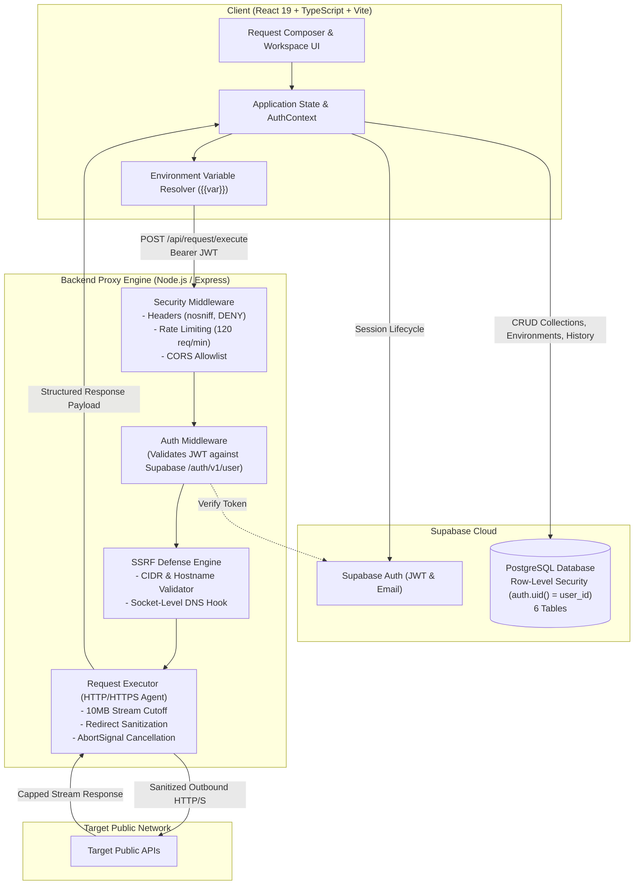
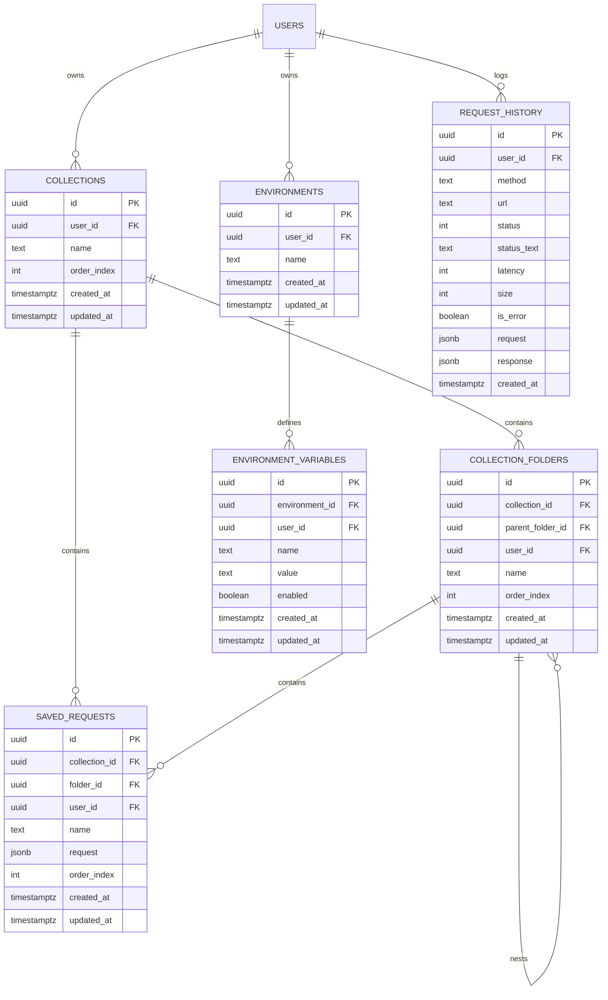

# APIForge

**APIForge** is a security-focused API development and testing platform built with React, TypeScript, Node.js, and Supabase. Designed as a modern web alternative to desktop API clients like Postman and Insomnia, APIForge combines a responsive browser workspace with a security-hardened backend proxy execution engine, multi-tenant database isolation, arbitrary-depth nested collections, environment variable interpolation, and automated multi-language code generation.

---

## Table of Contents

- [Problem Statement](#problem-statement)
- [Live Links](#live-links)
- [Key Features](#key-features)
- [System Architecture](#system-architecture)
- [Request Execution Lifecycle](#request-execution-lifecycle)
- [Security Architecture & Defenses](#security-architecture--defenses)
- [Database Design & Multi-Tenant Isolation](#database-design--multi-tenant-isolation)
- [Technology Stack](#technology-stack)
- [Project Structure](#project-structure)
- [Local Setup & Installation](#local-setup--installation)
- [Environment Configuration](#environment-configuration)
- [Testing & Quality Verification](#testing--quality-verification)
- [Production Deployment Guide](#production-deployment-guide)
- [Scope Boundaries & Current Limitations](#scope-boundaries--current-limitations)
- [Future Roadmap](#future-roadmap)
- [Author & Acknowledgments](#author--acknowledgments)
- [License](#license)

---

## Problem Statement

Modern web-based API testing applications face a fundamental architectural challenge:

1. **Browser CORS Constraints:** Standard browser security policies restrict direct client-side JavaScript (`fetch`/`XMLHttpRequest`) from issuing requests to arbitrary third-party endpoints unless the remote server explicitly enables cross-origin resource sharing.
2. **The Proxy Vulnerability Trade-Off:** Introducing a naive backend proxy to circumvent CORS immediately exposes the hosting infrastructure to **Server-Side Request Forgery (SSRF)**. Malicious or compromised requests can probe loopback interfaces (`127.0.0.1`), scan private subnets (`10.0.0.0/8`, `192.168.0.0/16`), harvest cloud instance metadata (`169.254.169.254`), or trigger DNS rebinding attacks.
3. **Data Isolation Risks:** Multi-tenant API clients that store saved endpoints, private keys, and environment variables require strict data isolation at the database layer to protect saved credentials against unauthorized cross-tenant exposure.

**APIForge addresses this problem** by pairing an authenticated client interface with an SSRF-defended Node.js proxy engine and a PostgreSQL database governed by Row-Level Security (RLS). All outbound network traffic is validated against IP CIDR classifications at both the DNS pre-flight stage and the low-level operating system socket boundary.

---

## Live Links

- **Web Application:** [https://api-forge-hazel.vercel.app](https://api-forge-hazel.vercel.app/)
- **Source Code Repository:** [https://github.com/Atharvakadu24/APIForge](https://github.com/Atharvakadu24/APIForge)
- **Backend Service:** Configured for deployment on Render via `render.yaml`

---

## Key Features

### 1. Request Composer & Execution
- **HTTP Methods:** Full support for `GET`, `POST`, `PUT`, `PATCH`, and `DELETE`.
- **Query Parameter Synchronization:** Real-time two-way synchronization between the raw URL string and an editable key-value parameter table.
- **Multiple Request Body Formats:**
  - `JSON`: Syntax-highlighted editor with format/prettify and parse validation.
  - `Raw Text`: Plain text payloads with configurable headers.
  - `x-www-form-urlencoded`: Key-value grid serializing to standard URL-encoded form data.
  - `multipart/form-data`: Key-value text fields with dynamic multipart boundary generation (binary file attachment is not currently supported).
- **Authentication Modes:**
  - Bearer Token injection.
  - API Key injection (configurable into either request headers or query parameters).
- **Execution Controls:** In-flight request cancellation via client `AbortSignal` (propagating upstream to abort active proxy sockets), configurable timeouts (1s–60s), and instant keyboard execution (`Ctrl+Enter` / `Cmd+Enter`).

### 2. Environment Variables & Dynamic Interpolation
- **Variable Syntax:** Reference environment variables anywhere using double curly braces (e.g., `{{baseUrl}}/api/v1/users`).
- **Scope Support:** Interpolation is supported across the request URL, query parameter values, header values, request body, and auth tokens.
- **Diagnostics:** Pre-flight variable resolution identifies undefined or disabled variables and surfaces structured error guidance before any network request is sent.
- **Environment Manager:** Modal interface to create, rename, toggle, and manage distinct development, staging, and production environments.

### 3. Hierarchical Workspace & Persistence
- **Arbitrary-Depth Folders:** Collections support multi-level nested folders (`collection_folders`) backed by composite foreign-key constraints.
- **Reordering & Item Movement:** Move requests and folders across collections and parent directories with automatic cycle-detection safeguards.
- **Request History:** 50-item FIFO execution log persisted in Supabase with latency metrics, status codes, payload snapshots, and multi-selection batch deletion (FIFO pruning is enforced at the client application tier).
- **Dirty State Tracking:** Visual unsaved indicators alert users when active editor parameters diverge from the saved collection baseline.

### 4. Developer Productivity Tools
- **Command Palette (`Ctrl+K` / `Cmd+K`):** Global omni-search indexing saved requests, folders, collections, active environments, and historical logs with keyboard navigation and category filtering.
- **Code Snippet Generation:** Generates copy-ready code snippets from the active request in four languages:
  - **cURL** (multiline with safe single-quote shell escaping)
  - **JavaScript Fetch** (ES module syntax)
  - **Python Requests**
  - **Axios** (Promise-based JavaScript)
- **Request Import & Export:** Export requests as standardized APIForge JSON files; import external APIForge request files with schema validation.
- **Responsive Workspace:** Optimized across mobile (320px+), tablet, and desktop viewports with an adaptive slide-over drawer and horizontally scrollable tab headers.

---

## System Architecture



---

## Request Execution Lifecycle

When an API request is dispatched from the UI, it traverses a deterministic pipeline:

```text
[User clicks "Send"]
         │
         ▼
1. Client-Side Variable Resolution
   ├── Deep-clones the active ApiRequest object.
   ├── Interpolates {{variable_name}} tokens against active environment variables.
   └── Halts immediately if any unresolved variables exist, displaying a 400 error.
         │
         ▼
2. Supabase Session Verification
   ├── Retrieves the active user JWT access token from the Supabase client.
   └── Aborts if unauthenticated, prompting the user to sign in.
         │
         ▼
3. Outbound Proxy Dispatch (POST /api/request/execute)
   ├── Dispatches payload with `Authorization: Bearer <token>` and client AbortSignal.
   ├── Rate Limiting Middleware checks client IP quota (120 req/min).
   └── Auth Middleware verifies JWT structure, expiration claim, and validates against Supabase.
         │
         ▼
4. Pre-Flight SSRF & URL Validation
   ├── Checks protocol allowlist (http: and https: only).
   ├── Validates port boundaries (1–65535) and rejects embedded URL credentials.
   ├── Blocks reserved hostnames (localhost, metadata.google.internal, etc.).
   └── Resolves DNS records asynchronously, verifying every IP against restricted CIDR blocks.
         │
         ▼
5. Outbound Socket Execution
   ├── Intercepts socket connection via custom Agent DNS lookup hook (mitigating DNS rebinding).
   ├── Dispatches HTTP/HTTPS request with target Host header and configured body.
   ├── Enforces stream byte-counter: aborts connection if response exceeds 10MB (HTTP 413).
   ├── Tears down upstream sockets immediately if client aborts or closes the connection prior to completion.
   └── Enforces timeout bounds (1s–60s), tearing down sockets on expiration (HTTP 504).
         │
         ▼
6. Redirect Handling & Header Sanitization
   ├── Follows up to 5 redirects manually per RFC specifications.
   ├── Re-validates each redirect target against SSRF protocol and IP rules.
   └── Strips Authorization, Cookie, and API keys when redirect crosses origins.
         │
         ▼
7. Structured Response Delivery
   └── Formats response envelope (status, statusText, headers, body, latency, size)
       and records request execution to Supabase history.
```

---

## Security Architecture & Defenses

APIForge implements defense-in-depth across the application and network tiers:

| Threat Vector | Mitigation Strategy | Implementation Details |
|---|---|---|
| **SSRF & Cloud Metadata Access** | Multi-layer IP & Hostname Filtering | Blocks IPv4 loopback (`127.0.0.0/8`, `0.0.0.0/8`), RFC 1918 subnets (`10.0.0.0/8`, `172.16.0.0/12`, `192.168.0.0/16`), Carrier-Grade NAT (`100.64.0.0/10`), Link-Local / Metadata (`169.254.0.0/16`), Multicast (`224.0.0.0/4`), Broadcast (`255.255.255.255/32`), and IPv6 loopback (`::1`), ULA (`fc00::/7`), link-local (`fe80::/10`), 6to4 (`2002::/16`), and NAT64 (`64:ff9b::/96`). |
| **DNS Rebinding (TOCTOU)** | Socket-Level Lookup Hook | Attaches `createSsrfSafeLookup` directly to `http.Agent` and `https.Agent`. Every IP returned by the OS resolver immediately prior to socket creation is validated. If any address in a dual-homed DNS response points to a restricted IP, the connection is aborted. |
| **Cross-Origin Credential Leaks** | Redirect Header Sanitization | When following redirects (up to 5 hops), `sanitizeRedirectHeaders` compares the redirect origin with the current origin. If origins differ, `Authorization`, `Cookie`, `Proxy-Authorization`, and custom API keys are stripped. |
| **Resource & Memory Exhaustion** | Strict Stream Cutoffs | Upstream response chunks are tracked in real-time. If accumulated bytes exceed `MAX_RESPONSE_SIZE` (10MB), streams and sockets are destroyed immediately (`activeRes.destroy()`), returning HTTP 413 without loading oversized data into memory. |
| **Unauthenticated Proxy Abuse** | JWT Gatekeeping & Rate Limiting | The execution endpoint requires valid Supabase JWT bearer tokens verified via `/auth/v1/user`. Unauthenticated access is rejected with HTTP 401. IP rate limiting enforces a fixed-window budget of 120 requests/minute. |
| **Data Leakage in Errors** | Sanitized Error Envelopes | Error handlers catch internal exceptions and map them to safe, allowlisted HTTP status codes. Target query parameters, internal file paths, and server stack traces are suppressed from client error responses. |

---

## Database Design & Multi-Tenant Isolation

User data is persisted in a Supabase PostgreSQL database structured into six core tables. Multi-tenant isolation is enforced at the database engine level via **Row-Level Security (RLS)**:



### Database Constraints & Access Controls
1. **Engine-Level RLS Enforcement:** Every table has Row-Level Security enabled with canonical policies enforcing `auth.uid() = user_id` on all `SELECT`, `INSERT`, `UPDATE`, and `DELETE` operations.
2. **Composite Foreign Keys:**
   - `collection_folders(collection_id, user_id)` &rarr; `collections(id, user_id)`
   - `collection_folders(parent_folder_id, collection_id)` &rarr; `collection_folders(id, collection_id)`
   - `saved_requests(collection_id, user_id)` &rarr; `collections(id, user_id)`
   - `environment_variables(environment_id, user_id)` &rarr; `environments(id, user_id)`
   *Security Benefit:* Even if an authenticated user attempts to insert a request or subfolder referencing another user's collection, the composite constraint rejects the insert with a relational violation.
3. **Fail-Closed Migration Audit:** Schema migrations include a PL/pgSQL preflight check inspecting `pg_policies`. If any permissive or unapproved policy is discovered on tenant tables, the migration aborts with `RAISE EXCEPTION`.

---

## Technology Stack

| Layer | Component | Version / Tools | Purpose |
|---|---|---|---|
| **Frontend** | Framework | React 19 (`^19.2.8`) | Reactive user interface & component hierarchy |
| | Language | TypeScript (`~6.0.2`) | Static type checking and safety |
| | Bundler | Vite 8 (`^8.2.2`) | Fast development server & production asset bundling |
| | Styling | Tailwind CSS (`^3.4.19`), PostCSS, Autoprefixer | Responsive utility-first styling |
| | Client SDK | `@supabase/supabase-js` (`^2.116.0`) | Client-side auth session & PostgreSQL queries |
| **Backend** | Runtime | Node.js (v18+) | Server-side execution environment |
| | Framework | Express 4 (`^4.19.2`) | HTTP routing and middleware pipeline |
| | Networking | Node native `net`, `dns`, `http`, `https` | Socket-level lookup hooks & request agents |
| | Transpilation | TypeScript (`^5.4.5`), `ts-node-dev` | Typed server compilation |
| **Database & Auth**| Database | PostgreSQL 15+ (Supabase) | Multi-tenant relational storage with JSONB support |
| | Security | PostgreSQL Row-Level Security (RLS) | Database-enforced tenant isolation |
| | Auth Service | Supabase Auth (GoTrue) | JWT session tokens, email confirmation, password recovery |
| **Tooling & Tests**| Linter | Oxlint (`^1.79.0`) | High-speed static code analysis |
| | Test Runners | Node.js Test Runner, `node:assert/strict` | Automated deterministic unit & integration tests |

---

## Project Structure

```text
APIForge/
├── backend/
│   ├── src/
│   │   ├── middleware/
│   │   │   ├── authMiddleware.ts     # Supabase JWT extraction, expiration & API verification
│   │   │   └── security.ts           # Rate limiting (120 req/min), CORS, security headers, error handlers
│   │   ├── routes/
│   │   │   └── executeRouter.ts       # POST /execute route with error envelope sanitization
│   │   ├── services/
│   │   │   ├── requestExecutor.ts    # HTTP/S execution, redirect loop handler, 10MB stream cutoff
│   │   │   └── ssrfValidator.ts      # CIDR math, IP/hostname allowlist, socket DNS interception hook
│   │   ├── types/
│   │   │   └── execution.ts          # Request & response payload interfaces
│   │   ├── config.ts                 # Environment variable resolution & reverse proxy configuration
│   │   └── server.ts                 # Express initialization, middleware mounting & server bootstrap
│   ├── .env.example                  # Backend environment configuration template
│   ├── package.json                  # Backend dependencies, compiler options & scripts
│   ├── testBackend.mjs               # 38-scenario automated backend security test suite
│   └── tsconfig.json                 # Backend TypeScript compiler settings
│
├── frontend/
│   ├── src/
│   │   ├── components/
│   │   │   ├── AppShell.tsx           # Responsive layout container with mobile sidebar drawer
│   │   │   ├── AuthScreen.tsx         # Sign-in, sign-up, password reset, and confirmation resend
│   │   │   ├── CodeSnippetModal.tsx   # Multi-language code snippet generator (cURL, Fetch, Python, Axios)
│   │   │   ├── CommandPaletteModal.tsx# Omni-search modal (Ctrl+K) indexing workspace items
│   │   │   ├── EnvironmentModal.tsx   # Environment manager and variable key-value editor
│   │   │   ├── ErrorBoundary.tsx      # React error boundary catching render exceptions to prevent white-screen crashes
│   │   │   ├── Header.tsx             # Workspace header with environment selector & account actions
│   │   │   ├── ImportRequestModal.tsx # APIForge JSON file upload & raw text parser
│   │   │   ├── RequestEditor.tsx      # Core request composer (URL, methods, params, headers, body, auth)
│   │   │   ├── ResponseBodyViewer.tsx # Formatted JSON viewer with search, line numbers, and copy action
│   │   │   ├── ResponsePanel.tsx      # Status badges, latency, payload metrics, and viewer tabs
│   │   │   └── Sidebar.tsx            # Collections tree, nested folders, history list, and modal triggers
│   │   ├── contexts/
│   │   │   ├── AuthContext.tsx        # Supabase auth session provider and lifecycle listeners
│   │   │   └── authContextDef.ts      # Context type definitions
│   │   ├── lib/
│   │   │   └── supabase.ts            # Supabase client singleton & configuration status checker
│   │   ├── services/
│   │   │   ├── collectionService.ts   # Collection & nested folder CRUD queries
│   │   │   ├── environmentService.ts  # Environment & variable CRUD queries
│   │   │   └── historyService.ts      # Request history queries & 50-item FIFO retention
│   │   ├── utils/
│   │   │   ├── codeGenerators.ts      # cURL, Fetch, Python, and Axios snippet formatters
│   │   │   ├── importExportUtils.ts   # APIForge JSON serialization and schema validation
│   │   │   ├── urlParamsSync.ts       # Two-way sync between URL query strings and parameter rows
│   │   │   └── variableResolver.ts    # Recursive {{variable}} template substitution engine
│   │   ├── App.tsx                    # Top-level workspace controller, state wiring & execution dispatcher
│   │   └── main.tsx                   # React root entry point
│   ├── .env.example                  # Frontend environment configuration template
│   ├── package.json                  # Frontend dependencies and build scripts
│   ├── tailwind.config.js            # Tailwind theme, colors, and responsive breakpoints
│   ├── testAuth.mjs                  # 23-scenario automated frontend authentication test suite
│   └── vite.config.ts                # Vite build plugins, proxy definitions & code splitting
│
├── supabase/
│   └── migrations/
│       ├── 20261010_milestone8_nested_folders_and_ordering.sql # Intermediate hierarchy migration
│       └── 20261011_production_schema_complete.sql            # Complete canonical production schema & RLS policies
├── render.yaml                        # Infrastructure-as-code definition for Render backend hosting
└── README.md                          # Project documentation
```

---

## Local Setup & Installation

### Prerequisites
- **Node.js:** v18.0.0 or higher
- **npm:** v9.0.0 or higher
- **Supabase Account:** A free project on [Supabase](https://supabase.com) (refer to the [Supabase Documentation](https://supabase.com/docs) for project creation)

### 1. Clone the Repository
```bash
git clone https://github.com/Atharvakadu24/APIForge.git
cd APIForge
```

### 2. Configure the Database
1. In your Supabase Dashboard, open the **SQL Editor**.
2. Run the migration script located at:
   ```text
   supabase/migrations/20261011_production_schema_complete.sql
   ```
3. This creates all six tables (`collections`, `collection_folders`, `saved_requests`, `environments`, `environment_variables`, `request_history`) with complete Row-Level Security policies, composite foreign keys, and indexes.

### 3. Configure Environment Files

**Backend Configuration:**
```bash
cd backend
cp .env.example .env
```
Populate `backend/.env` with your Supabase credentials:
```env
PORT=3001
ALLOWED_ORIGINS=http://localhost:5173,http://127.0.0.1:5173
SUPABASE_URL=https://your-project-id.supabase.co
SUPABASE_ANON_KEY=your-supabase-anon-or-publishable-key
```

**Frontend Configuration:**
```bash
cd ../frontend
cp .env.example .env.local
```
Populate `frontend/.env.local` with your Supabase credentials and local backend URL:
```env
VITE_SUPABASE_URL=https://your-project-id.supabase.co
VITE_SUPABASE_PUBLISHABLE_KEY=your-supabase-anon-or-publishable-key
VITE_BACKEND_URL=http://localhost:3001
```

### 4. Install Dependencies & Launch

**Terminal 1 — Backend Service:**
```bash
cd backend
npm install
npm run dev
# Server starts on http://localhost:3001
```

**Terminal 2 — Frontend Application:**
```bash
cd frontend
npm install
npm run dev
# Application starts on http://localhost:5173
```

Open `http://localhost:5173` in your browser, create an account, and begin testing APIs.

---

## Environment Configuration

The following table documents all environment variables used by APIForge across services:

### Backend Variables (`backend/.env`)

| Variable Name | Required | Default | Description |
|---|---|---|---|
| `PORT` | Optional | `3001` | HTTP port on which the Express backend listens. |
| `ALLOWED_ORIGINS` | Required | `http://localhost:5173,http://127.0.0.1:5173` | Comma-separated list of allowed CORS origins. In production, set to your frontend domain. |
| `SUPABASE_URL` | Required | *None* | Supabase project API URL (e.g., `https://xyz.supabase.co`). Used to verify JWTs via `/auth/v1/user`. |
| `SUPABASE_ANON_KEY` | Required | *None* | Supabase anonymous public API key. Used to authenticate backend calls to the Supabase Auth API. |
| `TRUST_PROXY` | Optional | `1` | Reverse proxy trust configuration. Set to `1` for single-hop proxies (Render/Railway) to ensure accurate client IP resolution in rate limiting. |

### Frontend Variables (`frontend/.env.local`)

| Variable Name | Required | Default | Description |
|---|---|---|---|
| `VITE_SUPABASE_URL` | Required | *None* | Supabase project API URL. Used by `@supabase/supabase-js` for auth and database queries. |
| `VITE_SUPABASE_PUBLISHABLE_KEY` | Required | *None* | Supabase public publishable/anon key. |
| `VITE_BACKEND_URL` | Optional | `http://localhost:3001` | URL of the APIForge backend proxy. In production, set to your hosted backend URL. |

> **Security Notice:** Do not commit `.env` or `.env.local` files to version control. Both filenames are included in the repository's `.gitignore`.

---

## Testing & Quality Verification

APIForge includes **61 automated deterministic test scenarios** covering backend SSRF defenses, proxy execution lifecycles, and frontend authentication flows.

> **Test Environment Note:** All 61 test scenarios run locally, offline, and deterministically without requiring external network connectivity or connections to live Supabase services. Backend tests exercise compiled production middleware and services against in-process Node.js HTTP servers and local Express instances. Frontend tests evaluate client authentication lifecycle, error mapping, and UI integrity using deterministic unit assertions and mock providers. PostgreSQL Row-Level Security policies are defined declaratively in SQL migrations; tenant isolation tests in the frontend suite evaluate user-scoped query construction and client-side filtering offline rather than executing against a live PostgreSQL instance.

### 1. Running Backend Security Tests
```bash
cd backend
npm test
```
**Results (38 / 38 Scenarios Passing):**
- **SSRFValidator (Scenarios 1–8):**
  - Blocks IPv4 loopback (`127.0.0.1`), private RFC 1918 subnets, CGNAT (`100.64.0.0/10`), broadcast, and cloud metadata (`169.254.169.254`).
  - Allows legitimate public IPv4 addresses.
  - Blocks IPv6 loopback (`::1`), unspecified (`::`), ULA (`fc00::/7`), and link-local (`fe80::/10`).
  - Blocks compressed and expanded IPv4-mapped addresses, NAT64 private prefixes, and local-use NAT64 (`64:ff9b:1::/48`).
  - Rejects malformed IPv6 strings and blocks the entire deprecated 6to4 prefix (`2002::/16`).
  - Blocks restricted hostnames (`localhost`, `metadata.google.internal`, bracketed hostnames, private TLDs).
  - Rejects unsupported protocols (`ftp:`, `file:`, `javascript:`) and embedded credentials.
  - Intercepts and rejects dual-homed DNS responses returning mixed public and restricted IPs (DNS rebinding).
- **RequestExecutorService (Scenarios 9–17):**
  - Sanitizes redirect headers case-insensitively on origin changes.
  - Rejects redirect attempts targeting loopback, cloud metadata, or blocked schemes.
  - Aborts response streams exceeding 10MB (`MAX_RESPONSE_SIZE`) with clean socket teardown.
  - Terminates upstream requests and destroys active sockets promptly when client `AbortSignal` fires.
  - Rejects slow responses with timeout errors and tears down connections.
  - Safely handles connection refused (`ECONNREFUSED`) and premature socket close (`ECONNRESET`).
  - Ensures the public API does not accept unauthorized agent injections.
- **Route Layer & Middleware (Scenarios 18–33):**
  - Sanitizes error envelopes; suppresses internal diagnostics and token leakage across DNS failures, SSRF blocks, and unhandled exceptions.
  - Enforces fixed-window rate limits (120 req/min) and normalizes fractional or negative configuration values.
  - Sets security headers (`nosniff`, `DENY`, strict referrer policy).
  - Handles oversized payloads (HTTP 413) and malformed JSON syntax (HTTP 400).
  - Returns structured 404 responses for unmatched endpoints.
- **Auth Middleware (Scenarios 34–38):**
  - Rejects missing, non-Bearer, empty, and non-segment token strings.
  - Rejects primitive and array JWT payloads safely without throwing `TypeErrors`.
  - Validates missing, zero, negative, and expired `exp` claims.
  - Sanitizes upstream network failures, returning generic HTTP 503 without leaking tokens or stack traces.

### 2. Running Frontend Authentication Tests
```bash
cd frontend
npm test
```
**Results (23 / 23 Scenarios Passing):**
- **Auth Lifecycle (Scenarios 1–12):** Valid sign-in, error formatting, auto-confirmed signups, confirmation-required signups, duplicate email handling, network failure guidance, password reset dispatch, `PASSWORD_RECOVERY` state transitions, password validation, expired recovery session handling, startup session restoration, and sign-out cleanup.
- **Integration & Security (Scenarios 13–14):** Bearer token dispatch formatting for proxy requests and offline evaluation of user-scoped query construction and tenant-isolation logic.
- **Email Confirmation & Resend (Scenarios 15–20):** Email confirmation error messaging, rate limit translation, configuration detection, normalization for resend requests, and single-field form validation.
- **Accessibility & UI Integrity (Scenarios 21–23):** Confirms top-level screen containers do not block text selection, code viewers isolate `select-none` strictly to line numbers, and the Command Palette provides an accessible close button and `Escape` listener.

### 3. Static Analysis & Compilations
```bash
# Frontend Linter (0 errors, 0 warnings across 50 files)
cd frontend
npm run lint

# Frontend Production Build (Type check + Vite bundle)
npm run build

# Backend Production Build (TypeScript compilation to dist/)
cd ../backend
npm run build
```

---

## Production Deployment Guide

### 1. Frontend Hosting (Vercel)
1. Import the repository into Vercel.
2. Set **Root Directory** to `frontend`.
3. Set **Build Command** to `npm run build`.
4. Set **Output Directory** to `dist`.
5. Configure Environment Variables:
   - `VITE_SUPABASE_URL`: Your production Supabase project URL.
   - `VITE_SUPABASE_PUBLISHABLE_KEY`: Your production Supabase anon/publishable key.
   - `VITE_BACKEND_URL`: The production URL of your deployed backend service.

### 2. Backend Hosting (Render)
The repository includes a `render.yaml` specification for Render:
1. Connect the repository in Render via **Blueprints** or create a **Web Service**.
2. Set **Root Directory** to `backend`.
3. Set **Build Command** to `npm install && npm run build`.
4. Set **Start Command** to `npm start`.
5. Configure Environment Variables:
   - `PORT`: `3001` (or host-assigned `$PORT`).
   - `ALLOWED_ORIGINS`: Your production frontend domain (e.g., `https://api-forge-hazel.vercel.app`).
   - `SUPABASE_URL`: Your production Supabase project URL.
   - `SUPABASE_ANON_KEY`: Your production Supabase anon key.
   - `TRUST_PROXY`: `1` (ensures accurate client IP extraction from Render's reverse proxy).

### 3. Supabase Auth Configuration
In your Supabase Dashboard:
1. Navigate to **Authentication &rarr; URL Configuration**.
2. Set **Site URL** to your production frontend URL (`https://api-forge-hazel.vercel.app`).
3. Add redirect URLs:
   - `https://api-forge-hazel.vercel.app/`
   - `https://api-forge-hazel.vercel.app/*`
4. In **Email Templates**, verify that confirmation and recovery links route through `{{ .ConfirmationURL }}` to your configured Site URL.

---

## Scope Boundaries & Current Limitations

To maintain architectural focus and security boundaries, APIForge explicitly limits the following scopes:

1. **REST Protocol Focus:** APIForge is designed for HTTP/HTTPS REST APIs. It does not currently support persistent full-duplex protocols (WebSockets), Server-Sent Events (SSE), or gRPC streams.
2. **Localhost Target Testing:** Because the backend execution engine actively blocks access to loopback (`127.0.0.1`) and local subnets to defend against SSRF vulnerabilities, users cannot directly test local development servers (e.g., `http://localhost:8080`) through the cloud-hosted backend. To test local services, expose the local service via a tunnel (such as Cloudflare Tunnel or ngrok) or deploy the target to a staging environment.
3. **In-Memory Rate Limiting:** The backend rate limiter uses an in-memory fixed-window record store (tracking request counts within discrete 60-second windows per client IP). In standard single-instance hosting (e.g., Render free/starter tiers), this provides effective single-process request throttling. In horizontally auto-scaled multi-container deployments, rate-limiting counters would be partitioned across instances unless backed by an external store.
4. **Single-Request Import/Export:** Import and export operations currently function at the individual request level using APIForge's JSON specification. Bulk collection imports (such as Postman Collection v2.1 or OpenAPI/Swagger JSON) are not yet implemented.
5. **Multipart Binary Attachments:** While `multipart/form-data` request assembly with dynamic boundary generation is fully implemented for text-based form fields, browser file attachment inputs (`<input type="file">`) are not currently provided in the UI.

---

## Future Roadmap

Planned enhancements for future development milestones:

- [ ] **Database-Level FIFO History Retention:** Transition client-side history range pruning to an `AFTER INSERT` PostgreSQL trigger on `request_history`.
- [ ] **cURL Command String Parser:** Support pasting raw `curl -X POST ...` strings into the URL bar to auto-populate request headers, method, and body.
- [ ] **Bulk Collection Import & Export:** Add support for importing and exporting entire folder hierarchies in OpenAPI 3.0 and Postman Collection v2.1 formats.
- [ ] **Distributed Rate Limiting:** Add an optional Redis adapter for `createRateLimiter` to support multi-container clustered deployments.
- [ ] **Response Certificate Details:** Surface TLS handshake metadata (cipher suite, certificate validity dates) for HTTPS targets.

---

## Author & Acknowledgments

- **Author:** [Atharva Kadu](https://github.com/Atharvakadu24)
- **Repository:** [Atharvakadu24/APIForge](https://github.com/Atharvakadu24/APIForge)

---

## License

The backend service is licensed under the [ISC License](https://opensource.org/licenses/ISC) (as declared in `backend/package.json`). The frontend package is configured as private. A standalone root license file is not currently present in the repository.
