# APIForge

**APIForge** is an enterprise-grade, security-hardened API testing and debugging platform built with React, TypeScript, Node.js, and Supabase. Inspired by developer tools like Postman and Insomnia, APIForge combines an intuitive web-based request composer with an SSRF-defended backend proxy execution engine, arbitrary-depth nested collections, environments with variable interpolation, request history, and Supabase Row-Level Security (RLS) multi-tenant isolation.

---

## Architecture Overview

```mermaid
graph TD
    subgraph Browser ["Client (Browser)"]
        UI["React 19 + TypeScript + Tailwind CSS"]
        EB["React ErrorBoundary"]
        State["Zustand/Local State + AuthContext"]
        UI --> EB
        EB --> State
    end

    subgraph Supabase ["Supabase Cloud"]
        Auth["Supabase Auth (JWT & Email)"]
        DB[("PostgreSQL Database\nRow-Level Security (RLS)\n6 Tables")]
    end

    subgraph Backend ["APIForge Backend (Node.js / Express)"]
        MW["Security Middleware\n- Headers (nosniff, DENY)\n- Rate Limiting (120 req/min)\n- Clean CORS Rejection"]
        JWT["Supabase Token Verification\n(auth.user endpoint)"]
        SSRF["SSRF Defense Engine\n- CIDR Range Validator\n- Socket-level DNS Hook\n- Stream Limiter (10MB)"]
        Proxy["HTTP/HTTPS Request Executor\n- Redirect Loop Protection\n- Cross-Origin Header Sanitizer"]
    end

    subgraph Upstream ["Public Internet"]
        TargetAPI["Target Public APIs / Endpoints"]
    end

    State -->|JWT Session / Direct Queries| DB
    State -->|Auth Lifecycle| Auth
    State -->|POST /api/request/execute\nBearer JWT| MW
    MW --> JWT
    JWT -->|Verify Token| Auth
    JWT --> SSRF
    SSRF --> Proxy
    Proxy -->|Sanitized HTTP/S Request| TargetAPI
    TargetAPI -->|Capped Stream Response| Proxy
    Proxy -->|Structured Response Payload| State
```



### Core Architecture Principles
1. **SSRF-Defended Backend Proxy**: Browser requests are dispatched through a dedicated Node.js execution engine rather than direct browser `fetch`, bypassing browser CORS restrictions while strictly enforcing SSRF defenses against internal networks, loopback addresses, and cloud instance metadata.
2. **Socket-Level DNS Hook**: Address resolution is intercepted directly on the Node.js `http`/`https` socket connection to prevent DNS rebinding attacks.
3. **Multi-Tenant Row-Level Security**: Every Supabase query (`collections`, `collection_folders`, `saved_requests`, `environments`, `environment_variables`, `request_history`) is protected by database-enforced RLS policies asserting `auth.uid() = user_id`.
4. **Resilient Request Lifecycle**: Supports cancellation via client `AbortSignal`, timeout bounds (1s to 60s), and a 10MB response stream cutoff to eliminate memory exhaustion.

---

## Key Features

- **Advanced Request Composer**:
  - Full HTTP method support (`GET`, `POST`, `PUT`, `PATCH`, `DELETE`).
  - URL editing with real-time two-way query parameter synchronization.
  - Multi-mode request bodies: JSON (with format & validation), Plain Text, `x-www-form-urlencoded`, and `multipart/form-data`.
  - Authentication schemes: Bearer Token and API Key (injected as header or query parameter).
- **Environment & Variable Interpolation**:
  - Define environment variables and reference them anywhere using `{{variable_name}}` (URL, headers, query params, request body, authentication).
  - Quick environment switching directly from the application header.
  - Unresolved variable detection with structured diagnostic error feedback.
- **Nested Collections & Hierarchy**:
  - Arbitrary-depth nested folders (`collection_folders`).
  - Persistent drag/move ordering across collections, folders, and saved requests.
  - Cycle-prevention safeguards preventing a folder from being moved into its own descendant.
- **Request History**:
  - Execution history persisted in Supabase with FIFO retention (50 items).
  - Single item and multi-selection batch deletion.
- **Developer Experience & Tooling**:
  - **Command Palette (`Ctrl+K` / `Cmd+K`)**: Fast global search across collections, folders, saved requests, environments, and history.
  - **Keyboard Shortcut (`Ctrl+Enter` / `Cmd+Enter`)**: Instantly execute requests from anywhere in the workspace.
  - **Multi-Language Code Generation**: Instant export to cURL, JavaScript `fetch`, Python `requests`, and `Axios` with safe string escaping.
  - **Import & Export**: Export requests as standardized APIForge JSON; import with schema validation.
- **Performance & Reliability**:
  - Monolithic bundle elimination via Vite vendor code splitting (`react`, `@supabase/supabase-js`, application code all under 260 kB).
  - React `ErrorBoundary` protecting against blank screens with instant reload and workspace reset options.
  - Virtualized/capped rendering for large response bodies (>1,000 lines) to eliminate tab freezing.

---

## Tech Stack

| Layer | Technologies |
|---|---|
| **Frontend** | React 19, TypeScript, Vite 8, Tailwind CSS, Lucide-style SVG icons |
| **Backend** | Node.js, Express, TypeScript, Node `net`/`dns`/`http`/`https` socket agents |
| **Database & Auth** | Supabase (PostgreSQL with Row-Level Security, Supabase Auth) |
| **Testing** | Node.js Test Runner, `node:assert/strict`, Oxlint, TypeScript strict mode |

---

## Local Setup & Installation

### Prerequisites
- Node.js (v18.0.0 or higher)
- npm (v9.0.0 or higher)
- A free [Supabase](https://supabase.com) project

### 1. Clone the Repository
```bash
git clone https://github.com/Atharvakadu24/APIForge.git
cd APIForge
```

### 2. Configure Backend Environment
Navigate to `backend/` and create `.env`:
```bash
cd backend
cp .env.example .env
```
Edit `backend/.env`:
```env
PORT=3001
ALLOWED_ORIGINS=http://localhost:5173,http://127.0.0.1:5173
SUPABASE_URL=https://your-project-id.supabase.co
SUPABASE_ANON_KEY=your-supabase-anon-or-publishable-key
```

### 3. Configure Frontend Environment
Navigate to `frontend/` and create `.env.local`:
```bash
cd ../frontend
cp .env.example .env.local
```
Edit `frontend/.env.local`:
```env
VITE_SUPABASE_URL=https://your-project-id.supabase.co
VITE_SUPABASE_PUBLISHABLE_KEY=your-supabase-anon-or-publishable-key
VITE_BACKEND_URL=http://localhost:3001
```

### 4. Database Setup (Supabase)
In your Supabase Dashboard:
1. Open the **SQL Editor**.
2. Run the migration script located at:
   `supabase/migrations/20261011_production_schema_complete.sql`
3. This creates all 6 tables (`collections`, `collection_folders`, `saved_requests`, `environments`, `environment_variables`, `request_history`) with complete Row-Level Security policies and indexes.

### 5. Install Dependencies & Start Applications

**Start the Backend**:
```bash
cd backend
npm install
npm run dev
# Backend runs on http://localhost:3001
```

**Start the Frontend**:
```bash
cd ../frontend
npm install
npm run dev
# Frontend runs on http://localhost:5173
```

---

## Verification & Test Results

APIForge includes a 28-scenario deterministic automated test suite covering frontend authentication and backend SSRF security.

### Running Backend Security Tests
```bash
cd backend
npm test
```
**Results (14/14 Scenarios Passing)**:
- `[PASS]` Scenario 1: Blocks IPv4 loopback (127.0.0.1), private RFC1918 (10.x, 172.16.x, 192.168.x), and link-local cloud metadata (169.254.169.254).
- `[PASS]` Scenario 2: Permits legitimate public IPv4 destinations (e.g. 8.8.8.8, 1.1.1.1).
- `[PASS]` Scenario 3: Blocks IPv6 loopback (`::1`), unspecified (`::`), ULA (`fc00::`), link-local (`fe80::`), IPv4-mapped, and NAT64 prefixes.
- `[PASS]` Scenario 4: Blocks restricted hostnames (`localhost`, `metadata.google.internal`, `instance-data`, `.internal`, `.local`).
- `[PASS]` Scenario 5: Enforces HTTP/HTTPS protocol allowlist and rejects `file://`, `ftp://`, `gopher://`, `javascript:`.
- `[PASS]` Scenario 6: Rejects URLs with embedded credentials to prevent credential leaks.
- `[PASS]` Scenario 7: Normalizes and blocks alternate IPv4 representations (decimal, octal, hex loopback).
- `[PASS]` Scenario 8: Strips `Authorization`, `Cookie`, and API keys case-insensitively on cross-origin redirects.
- `[PASS]` Scenario 9: Rate limiter restricts excess requests (120 req/min) and injects `X-RateLimit` headers.
- `[PASS]` Scenario 10: Security headers middleware sets `X-Content-Type-Options: nosniff`, `X-Frame-Options: DENY`, and `Referrer-Policy`.
- `[PASS]` Scenario 11: Global error handler sanitizes JSON syntax errors and suppresses stack traces.
- `[PASS]` Scenario 12: 404 handler returns structured JSON for undefined endpoints.
- `[PASS]` Scenario 13: Validates JWT segment structure and locally rejects expired tokens.
- `[PASS]` Scenario 14: Response size tracking terminates upstream streams exceeding 10MB with status 413.

### Running Frontend Authentication Tests
```bash
cd frontend
node testAuth.mjs
```
**Results (14/14 Scenarios Passing)**:
- `[PASS]` Scenarios 1–14: Valid sign-in, invalid credential formatting, email confirmation requirement, duplicate registration, network failure guidance, password reset dispatch, recovery token session transitions, password validation, expired session recovery, session persistence on refresh, sign-out cleanup, proxy session token dispatch, and multi-tenant RLS query isolation.

### Linting & Production Build
```bash
# Frontend Lint
cd frontend
npm run lint    # 0 errors, 0 warnings (oxlint)

# Frontend Build
npm run build   # TypeScript check + Vite build (chunks < 260 kB)

# Backend Build
cd ../backend
npm run build   # Clean tsc compilation to dist/
```

---

## Security Design & Limitations

### Defense-in-Depth Model
- **Pre-flight URL & DNS Check**: Resolves destination hostnames and validates all resolved IP records against restricted CIDR blocks prior to initiating requests.
- **Socket-Level DNS Hook**: Attaches a custom `lookup` hook to Node's `http.Agent` and `https.Agent` to validate addresses at the OS socket connection boundary, defending against DNS rebinding (TOCTOU) attacks.
- **Cross-Origin Sanitization**: Automatically deletes `Authorization`, `Cookie`, and user API key headers when an HTTP redirect crosses origin boundaries (e.g. `api.example.com` -> `cdn.other.com`).
- **Stream Cutoff**: Responses larger than 10MB are aborted immediately at the socket level to prevent heap memory exhaustion (OOM).
- **No Sensitive Logging**: Request bodies, Authorization tokens, and sensitive headers are never logged to stdout or files.

### Explicit Security Scope & Limitations
- **Intended Purpose**: APIForge is intended for testing public HTTP/REST APIs. It intentionally blocks access to `localhost`, local private networks (`10.0.0.0/8`, `172.16.0.0/12`, `192.168.0.0/16`), and cloud metadata services (`169.254.169.254`).
- **Self-Hosted Testing**: To test services running on local machines, run your target service with a public reverse proxy (such as Cloudflare Tunnel or ngrok) or deploy the target to a staging environment.

---

## Production Deployment Checklist

### 1. Frontend (Vercel / Netlify / Cloudflare Pages)
- [ ] Connect the GitHub repository.
- [ ] Root directory: `frontend`.
- [ ] Build command: `npm run build`.
- [ ] Output directory: `dist`.
- [ ] Set environment variables:
  - `VITE_SUPABASE_URL`: Your production Supabase project URL.
  - `VITE_SUPABASE_PUBLISHABLE_KEY`: Your production Supabase publishable/anon key.
  - `VITE_BACKEND_URL`: The production URL of your hosted backend service (e.g. `https://api.yourdomain.com` or Render service URL).

### 2. Backend (Render / Railway / Fly.io)
- [ ] Root directory: `backend`.
- [ ] Build command: `npm install && npm run build`.
- [ ] Start command: `node dist/server.js`.
- [ ] Set environment variables:
  - `PORT`: `3001` (or host-provided `$PORT`).
  - `ALLOWED_ORIGINS`: Your production frontend URL (e.g. `https://apiforge.vercel.app`).
  - `SUPABASE_URL`: Your production Supabase project URL.
  - `SUPABASE_ANON_KEY`: Your production Supabase publishable/anon key.

### 3. Supabase Dashboard Configuration
- [ ] **Authentication -> URL Configuration**:
  - Set **Site URL** to your production frontend URL (`https://apiforge.vercel.app`).
  - Add your production domain and redirect paths to **Redirect URLs**:
    - `https://apiforge.vercel.app/`
    - `https://apiforge.vercel.app/*`
- [ ] **Email Templates**:
  - Verify that Confirmation and Password Reset emails include `{{ .ConfirmationURL }}` redirecting to your configured Site URL.
- [ ] **SQL Editor**:
  - Ensure `supabase/migrations/20261011_production_schema_complete.sql` has been applied to establish tables, indexes, and RLS policies.

---

## Recommended Portfolio Showcase & Screenshots

For LinkedIn, GitHub, or portfolio presentations, capture and present these 6 key screenshots:

1. **The Core Request Composer**: Active request with method badge, URL with parameters, syntax-highlighted JSON body editor, and responsive send button.
2. **Response Viewer & Pretty Search**: Completed response with status badge (e.g., `200 OK`), latency, size, pretty JSON highlighting, and active text search with highlighted marks.
3. **Nested Collections & Hierarchy**: Sidebar showing multi-level folders (`Auth / V1`, `Payments / Webhooks`), folder counts, request badges, and the drag/move modal.
4. **Environment Manager & Variable Resolver**: Environment modal displaying variables (`baseUrl`, `apiKey`) and the editor showing interpolated `{{baseUrl}}` placeholders.
5. **Multi-Language Code Snippets**: Code generator modal displaying generated cURL and JavaScript fetch snippets for the active request.
6. **Command Palette (`Ctrl+K`)**: Global search dialog open with instant search across requests, folders, collections, and history.

---

## License

ISC License. Built with passion for software engineering excellence.
